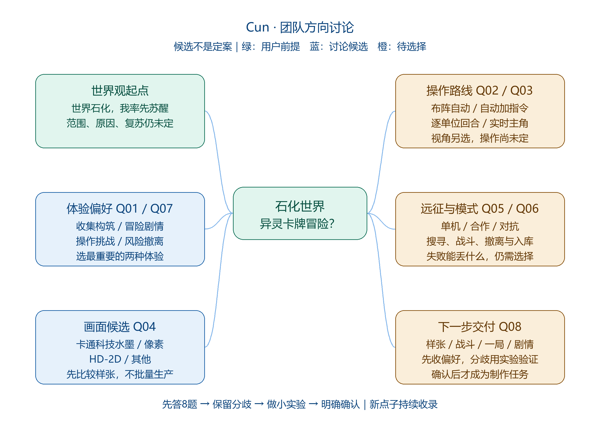
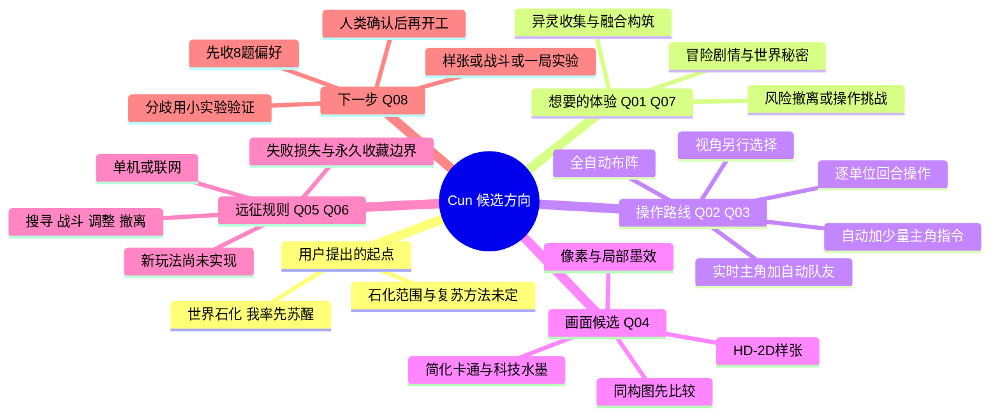

# 发给伙伴的一页说明与思维导图

**状态：候选方向讨论，不是定案或开工单。** 当前主入口是[完整Agent讨论材料](agent-discussion-kit.md)，每人发给自己的Agent、自己总结自己看，不要求集中填票。以下脑图与8题选择表保留为辅助，不是必须遵循的回收流程。本包不包含成员聊天截图、姓名或真实投票结果。

## 可以直接复制到群里的话

> 我们先不用急着加功能，先确认大家想做的是不是同一款游戏。
>
> 我给出的世界观起点是“全世界都变成了石头，我复活了”；具体石化规则还没定。讨论过的方向包括异灵卡牌收集、冒险剧情、融合构筑、随机远征与搜打撤，画面倾向2.5D/非写实，但操作和画风仍有分歧。
>
> 这张导图只是把想法摆出来，不是已经选定“全自动战斗”或“像素风”。把完整讨论材料发给自己的Agent，让它帮你解释候选、梳理自己的偏好，你自己看总结就行，不需要交票或发回；愿意分享时再交流。
>
> 第一步选的是方向和想先看的小实验，不要求现在承诺开发完整游戏。新点子继续放进想法池，不会因为暂不做就丢掉。

## 群聊转发版



- [PNG 导图](../../share/cun-discussion-map.png)：适合发群和手机放大查看。
- [SVG 导图](../../share/cun-discussion-map.svg)：矢量版本，可无损缩放；没有脚本、外链资源或成员资料。
- [8题选择票](ballot-round-1.md)：项目维护源；[纯文本转发版](../../share/ballot-round-1.txt)可直接复制到群里，不需要在线问卷服务。
- [40题问题总表](questions.md)：分轮讨论，不让大家一次填长表。
- [奇思妙想池](ideas.md)：新增、澄清、延后、确认的唯一收录入口。

图中绿色标示用户已提出的前提，蓝色标示讨论过的候选，橙色标示必须选择/验证的部分。绿色不意味着石化细节已经确定；蓝色不意味着团队同意所有候选。图只展示主干，细节以文字文档为准。

## 可编辑的文本脑图

GitHub支持的Mermaid语法用于维护结构；转发时使用PNG，不要求伙伴安装任何工具。此处展示候选与问题，不自动统计或更新投票。



## 候选循环的文字版

据点准备 → 探索/搜寻 → 战前调整 → 战斗 → 获得卡牌/线索 → 融合或恢复 → 撤离或深入 → 结算回流。

这条循环来自[候选规划](project-plan.md)，不是已经批准的唯一玩法。若团队更偏剧情轻冒险、逐单位回合或实时动作，循环中的战斗、风险和输入需要随之调整，不强迫所有投票选项都符合这一方案。

## 如何避免讨论越聊越散

先对齐最想要的两种体验，再选操作路线、画面样张和当前模式；不要只投“喜欢哪款参考游戏”。把参考游戏拆成具体体验，而不是要求同时复刻它们。

各自先梳理个人偏好与不确定，不读取或汇总伙伴的私人Agent对话。只有本人愿意分享且实际确认的团队决定，才更新[问题清单](questions.md)状态。无需先创建服务器、长篇商业架构或全部美术。

## 维护与重新导出

[讨论包导出脚本](../../tools/export_discussion_pack.py)从选择票和问题总表读取Q编号、选项与表格，生成自包含HTML；导图的六个主干标签在脚本的 `NODES` 中维护。改选项不改既有Q编号；改主干时同步这里的Mermaid，重新导出，避免图片与正文漂移。

```sh
# 生成SVG、PNG与离线HTML；PNG需要Pillow及本机中文字体。
python tools/export_discussion_pack.py
# 其他系统可显式提供中文字体路径。
python tools/export_discussion_pack.py --font /path/to/cjk-font.ttf
# 没有Pillow/字体时，只生成SVG和HTML；既有PNG不会更新，勿当新版发出。
python tools/export_discussion_pack.py --skip-png
```

导出物在 `share/`，无网络请求；脚本只覆盖自己的四个固定导出文件，不创建在线投票或收集成员答复。伙伴打开HTML不需要Python、Pillow、字体安装或服务器。

## 当前规划入口

- [世界观与玩法规划](project-plan.md)：其中的推荐连接方式仍是AI候选建议。
- [首个可玩版本](first-playable.md)：只有确认操作路线后，才决定是否按此实施。

投票和计划不会覆盖现有Godot原型，也不会修改玩家存档。本次文件仅在本地准备，未经明确要求不推送远端或创建公开调查。
